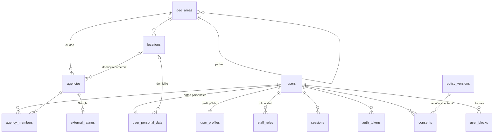
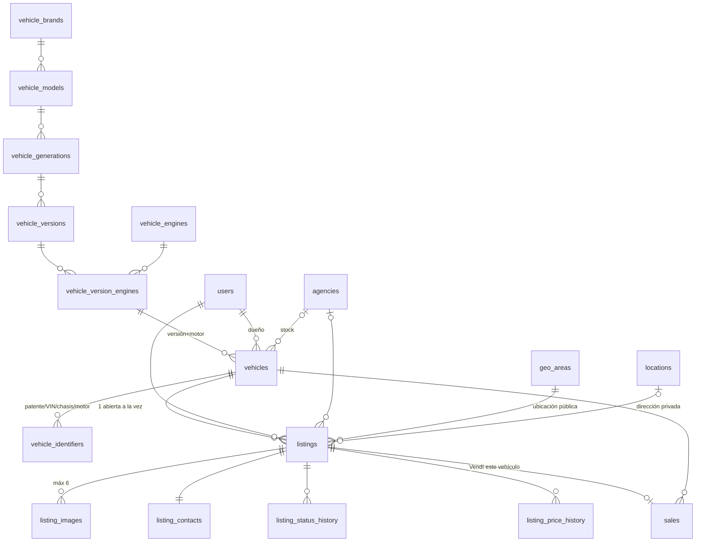
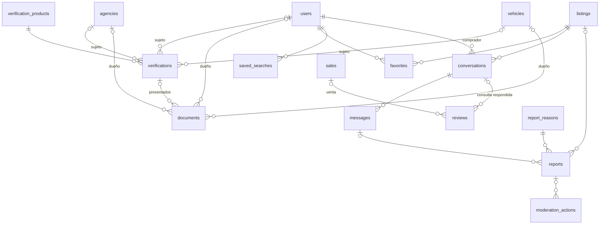
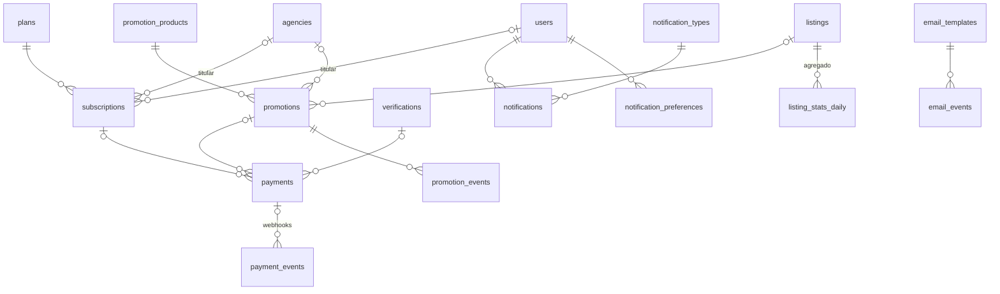

# Girando — Modelo de datos y arquitectura de backend v0

> **Estado:** PROPUESTA PARA APROBAR. No hay migraciones aplicadas en ningún entorno.
> El SQL de `db/propuesta/*.sql` es la especificación ejecutable del modelo: se cargó y se probó en PostgreSQL 16 local (`bash db/cargar_local.sh` → 50 verificaciones de flujo en `db/tests/900_flujos.sql`, todas OK).
> Campo por campo (tipo, obligatorio, default, visibilidad, FKs, checks, índices, políticas): **`02-diccionario-de-datos.md`** (generado del catálogo real).

---

## 0. Principios y arquitectura

```
App (Next.js / móvil) ─┐                          ┌─ Cloudinary (fotos)            [pendiente]
Admin (Next.js) ───────┼─► API FastAPI ──► PostgreSQL 16 (fuente de verdad, RLS)
                       │     │   ▲                └─ Bucket privado S3/R2 (docs)  [pendiente]
                       │     ▼   │
                       │   Worker (Celery + Redis): webhooks MP, vencimientos,
                       │   retención, emails, agregados de estadísticas
Mercado Pago ──webhook─┘                            Proveedor email              [pendiente]
```

1. **Una sola fuente de verdad: la base.** App y Admin leen el mismo estado por la API. Ningún estado se duplica en el frontend: el frontend *muestra* `agency.status`, `listing.status`, `subscription.status`; no los decide.
2. **El backend aplica reglas; la base las garantiza.** FastAPI valida (Pydantic) y devuelve errores amigables; triggers y constraints repiten las invariantes críticas (límite de plan, máquina de estados, 6 fotos, nadie se autoaprueba) para que ni un bug ni un cliente malicioso las rompan. Errores propios: `GR403` no permitido, `GR409` límite/conflicto (`LIMITE_ALCANZADO`), `GR422` datos inválidos, `GR429` anti-spam.
3. **Privacidad por separación de tablas, no por disciplina.** Lo sensible vive en tablas distintas (`user_personal_data`, `vehicle_identifiers`, `documents`, `locations`) y lo público solo sale por vistas `api_public.*` con columnas explícitas. Un visitante no tiene permiso sobre ninguna tabla.
4. **Historia antes que borrado.** Nada con valor estadístico, de auditoría o legal se borra físicamente: estados + anonimización + retención configurable.
5. **Integraciones = eventos.** Mercado Pago, Cloudinary y email notifican; el worker consulta al proveedor y actualiza la base. La URL de retorno de MP no activa nada.
6. **Normalizado, con derivados solo donde se justifican** (y marcados como reconstruibles): `listing_stats_daily`, `users.identity_verified_at` (caché mantenida por trigger), `search_vector`, `attributed_to_girando` (columna generada).

**Stack recomendado** (coherente con lo que ya usás): PostgreSQL 16 · FastAPI + Pydantic v2 + SQLAlchemy 2 + Alembic · Celery + Redis · Next.js/TypeScript. Si se elige Supabase, el modelo no cambia: se reemplaza `app.app_current_user_id()` por `auth.uid()` y los roles `girando_anon/app/worker` por `anon/authenticated/service_role`.

**Roles de base:** `girando_anon` (solo `api_public.*`), `girando_app` (usuario autenticado o staff; el backend hace `SET LOCAL app.user_id`), `girando_worker` (webhooks y jobs). El staff se reconoce por la tabla `staff_roles`, **no por el JWT**.

---

## 1. Entidades (59 tablas)

Las 36 pedidas están todas. Las 23 adicionales están marcadas con ➕ y su justificación.

### Identidad y cuenta
| Entidad | Propósito |
|---|---|
| `users` | Autenticación y estado de la cuenta (email, hash, verificaciones, bloqueo, último acceso). Sin datos personales. |
| ➕ `user_personal_data` | Nombre legal, DNI (cifrado + hash), fecha de nacimiento, domicilio. **Separar autenticación / personal / público lo pediste explícitamente**; sin esta tabla el DNI terminaría en `users`. |
| `user_profiles` | Perfil público: nombre visible, avatar, ciudad, redes (Instagram, TikTok, Facebook, X, YouTube, web), preferencias de visibilidad. |
| ➕ `staff_roles` | Roles del panel (superadmin, admin, moderator, finance, support, catalog_editor) con historial. Necesario para "un administrador accede según su rol" y para que el rol se verifique en la base. |
| `sessions` | Sesiones/dispositivos, IP, user agent, último acceso, cierre y motivo. |
| ➕ `auth_tokens` | Tokens de un uso (verificar email, recuperar contraseña, OTP, cambio de email). El prototipo ya tiene el flujo de recuperación en 4 pasos. |
| ➕ `login_attempts` | Intentos de login para bloqueo por intentos fallidos (el prototipo muestra "Ingreso bloqueado por intentos fallidos"). |
| ➕ `user_blocks` | Bloqueo entre usuarios (pedido en mensajería). |
| `consents` | Consentimientos append-only (versión, necesarias/preferencias/analítica/marketing, estado, canal, fecha y fecha de reemplazo). |
| ➕ `policy_versions` | Qué texto exacto (versión + hash) se aceptó. Sin esto "versión de política" es un string sin respaldo. |

### Ubicación
| Entidad | Propósito |
|---|---|
| ➕ `geo_areas` | Árbol país → provincia → departamento → localidad (con código oficial y centroide). Reemplaza las 4 tablas de referencia por una autorreferenciada. Es la ubicación **pública aproximada**. |
| `locations` | Dirección **exacta** (calle, número, CP, barrio, lat/lng). Privada salvo el local de una agencia. |

### Agencias
| Entidad | Propósito |
|---|---|
| `agencies` | Razón social, nombre comercial, CUIT (validado), datos comerciales, redes, dirección, horarios, estado de verificación. |
| `agency_members` | Usuarios que operan la agencia con rol owner/admin/seller. |
| ➕ `external_ratings` | Puntaje/cantidad/URL/sincronización de Google, **separado** de las reseñas de Girando (pedido explícito). |

### Catálogo maestro
| Entidad | Propósito |
|---|---|
| `vehicle_brands` → `vehicle_models` → `vehicle_generations` → `vehicle_versions` | Jerarquía con estado active/inactive y FKs `RESTRICT` (no se borra lo usado). |
| `vehicle_engines` | Motores reutilizables: cilindrada, potencia, torque, combustible, aspiración. |
| ➕ `vehicle_version_engines` | Tabla puente N:N versión ↔ motor. Una versión puede ofrecer más de un motor y un motor se usa en muchas versiones; el vehículo referencia la **combinación válida** con FK compuesta. |
| ➕ `catalog_requests` | "No encuentro mi versión": el texto libre queda como pedido al staff, nunca como identidad del vehículo. |

### Vehículo y publicación
| Entidad | Propósito |
|---|---|
| `vehicles` | El objeto físico: versión+motor, año, color, override de combustible (GNC). |
| ➕ `vehicle_identifiers` | Patente, VIN, chasis, número de motor — **una fila por identificador** con su estado declared/pending/verified/rejected, historial y fecha de purga. Sensibles. |
| `listings` | La oferta: precio, moneda, km, título, descripción, condición, ubicación pública, video, estados y fechas. |
| `listing_images` | Referencias Cloudinary (public_id, URL, tamaño, dimensiones, tipo, posición, portada, estado). |
| `listing_contacts` | Canales de contacto **de la publicación** (1:1), con `show_*` por canal. |
| ➕ `listing_status_history` | Cada transición con motivo y actor. Base de "días hasta vender", historial y motivos visibles al vendedor. |
| ➕ `listing_price_history` | Cambios de precio. El prototipo ya notifica "Bajó el precio de un favorito" y compara precio publicado vs final. |
| `documents` | Archivos privados con metadatos (dueño usuario/agencia/vehículo, verificación, storage, hash, vencimiento, revisión). |

### Confianza y moderación
| Entidad | Propósito |
|---|---|
| `verification_products` | Productos configurables (identidad, agencia, documentación, existencia, datos, inspección física) con texto de qué certifican. |
| `verifications` | Solicitudes concretas con sujeto (usuario/agencia/vehículo/publicación), revisor, decisión, vencimiento, revocación. |
| `reviews` | Reseñas Girando atadas a una conversación respondida o a una venta; una por interacción. |
| ➕ `report_reasons` | Motivos configurables (pedido explícito: "Motivos configurables"). |
| `reports` | Reportes sobre publicación/usuario/agencia/mensaje/reseña. |
| `moderation_actions` | Quién hizo qué, sobre qué y por qué. |

### Interacción
`favorites`, `saved_searches` (filtros + `notification_enabled`), `conversations` (comprador ↔ vendedor/agencia sobre una publicación), `messages`.

### Comercial
| Entidad | Propósito |
|---|---|
| `plans` | Entitlements tipados (límite, destacadas, estadísticas, verificación, miembros) editables por el admin. |
| `subscriptions` | Estado financiero del plan de un usuario o agencia; **determina permisos**. Precio congelado. |
| `payments` | Cobros MP o transferencia; sin datos de tarjeta. |
| `payment_events` | Webhooks recibidos, firma, idempotencia, snapshot del recurso consultado. |
| ➕ `exchange_rates` | Reemplaza `USD_RATE = 1250`. Necesaria para ordenar/filtrar ARS vs USD y sumar ventas en una moneda. |
| ➕ `promotion_products` | Catálogo de productos de exposición con precio/duración editables (hoy `PROMO_PRODUCTS` hardcodeado). |
| `promotions` | Una compra/campaña: publicación, agencia o banner; fechas, estado, prioridad, rótulo obligatorio. |
| `promotion_events` | Ciclo de vida de la promoción (las métricas salen de `analytics_events`, no se duplican). |
| `sales` | Venta histórica ("Vendí este vehículo"). |

### Comunicación
`notifications`, ➕ `notification_types` (catálogo de eventos y canales — la sección *Notificaciones* del admin), ➕ `notification_preferences` (la pantalla *Preferencias de comunicación*), `email_templates`, `email_events`.

### Plataforma
`audit_logs`, `analytics_events` (particionada por mes), ➕ `listing_stats_daily` (agregado reconstruible para el panel del vendedor), ➕ `app_settings` (60 días, aviso a 3, 6 fotos, 10 conversaciones/día, muestra mínima 3, datos bancarios — hoy constantes en el código), ➕ `retention_policies` (la sección *Retención de datos* del admin).

**Fuera de alcance a propósito:** Empleos, Servicios y Repuestos (fase 2 del plan). El modelo no los bloquea: `agencies` es una organización genérica (se le agrega `kind`), las notificaciones ya tienen categoría `applications` y `analytics_events` tiene `listing_application`.

---

## 2. Privacidad: clasificación

Cada columna tiene su etiqueta en el diccionario. Resumen de los datos críticos:

| Dato | Clase | Dónde vive | Cómo se protege |
|---|---|---|---|
| Email de login | PRIVADO | `users.email` | Nunca en vistas públicas |
| Contraseña, tokens, 2FA | SISTEMA | `users.password_hash`, `auth_tokens.token_hash`, `sessions.refresh_token_hash` | Solo hashes; redactados en auditoría |
| DNI | SENSIBLE | `user_personal_data.dni_encrypted` + `dni_hash` + `dni_last3` | Cifrado a nivel app (clave fuera de la DB); hash para duplicados |
| Fecha de nacimiento | SENSIBLE | `user_personal_data.birth_date` | Solo si un producto la requiere |
| Dirección exacta | PRIVADO/SENSIBLE | `locations` | Particular: nunca pública; agencia: domicilio comercial público |
| Ciudad | PÚBLICO | `geo_areas` vía `listings.geo_area_id` | "Godoy Cruz, Mendoza" + centroide del área |
| WhatsApp / teléfono / email de contacto | PRIVADO salvo `show_*` | `listing_contacts` | Vista `api_public.listing_contact` devuelve NULL si no está habilitado; la API solo lo sirve autenticado y registra `listing_contact_reveal` |
| Patente, VIN, chasis, n.º de motor | SENSIBLE | `vehicle_identifiers` | Sin grant para visitantes; RLS dueño + moderación; purga por retención |
| Documentos | SENSIBLE | `documents` + bucket privado | URL firmada de 5 min, generada y auditada por el backend |
| Pagos y suscripción | PROPIETARIO | `payments`, `subscriptions` | RLS: titular / miembros admin de la agencia / finanzas |
| Quién guardó en favoritos | PROPIETARIO | `favorites` | El vendedor solo ve el conteo |
| Quién reportó | ADMIN | `reports.reporter_user_id` | Nunca se revela al reportado |
| CUIT y razón social | PRIVADO | `agencies` | Se usan para verificar; lo público es el nombre comercial y el sello |

Verificado por test: ninguna vista de `api_public` expone email de login, DNI, identificadores del vehículo, calle/número de particulares, coordenadas exactas, hashes, CUIT ni razón social.

---

## 3. Relaciones

### Cardinalidades

| Relación | Tipo | Detalle |
|---|---|---|
| users — user_personal_data | 1:1 | PK = FK `user_id` |
| users — user_profiles | 1:1 | PK = FK `user_id` |
| users — staff_roles | 1:N | un rol activo por (usuario, rol) |
| users — sessions / auth_tokens / login_attempts | 1:N | |
| users ↔ users (bloqueos) | N:N | `user_blocks` |
| users ↔ agencies | N:N | `agency_members` (rol), 1 owner activo por agencia |
| geo_areas — geo_areas | 1:N | árbol por `parent_id` |
| geo_areas — locations / listings / agencies / user_profiles | 1:N | ubicación pública |
| agencies — locations | N:1 | domicilio comercial |
| brand → model → generation → version | 1:N en cada nivel | `ON DELETE RESTRICT` |
| vehicle_versions ↔ vehicle_engines | N:N | `vehicle_version_engines` |
| vehicle_version_engines — vehicles | 1:N | FK compuesta (version_id, engine_id) |
| users / agencies — vehicles | 1:N | dueño en Girando |
| vehicles — vehicle_identifiers | 1:N | una fila vigente por tipo |
| vehicles — listings | 1:N | a lo sumo **una abierta** (índice único parcial) |
| users / agencies — listings | 1:N | la publicación de agencia pertenece a la agencia |
| listings — listing_images | 1:N | máx. 6 activas, 1 portada |
| listings — listing_contacts | 1:1 | se crea con la publicación |
| listings — listing_status_history / listing_price_history | 1:N | append-only |
| listings — sales | 1:0..1 | una venta vigente por publicación |
| users ↔ listings (favoritos) | N:N | `favorites` |
| listings — conversations | 1:N | una por (publicación, comprador) |
| conversations — messages | 1:N | |
| users/agencies/vehicles — documents | 1:N | arco exclusivo: exactamente un dueño |
| verification_products — verifications | 1:N | |
| users/agencies/vehicles/listings — verifications | 1:N | arco exclusivo: exactamente un sujeto |
| verifications — documents | 1:N | documentos presentados |
| conversations / sales — reviews | 1:N | una reseña por autor e interacción |
| report_reasons — reports | 1:N | |
| listings/users/agencies/messages/reviews — reports | 1:N | arco exclusivo |
| plans — subscriptions | 1:N | |
| users / agencies — subscriptions | 1:N | a lo sumo una abierta por titular |
| subscriptions / promotions / verifications — payments | 1:N | arco exclusivo por propósito |
| payments — payment_events | 1:N | |
| promotion_products — promotions | 1:N | |
| listings / agencies — promotions | 1:N | según tipo |
| promotions — promotion_events | 1:N | |
| notification_types — notifications | 1:N | |
| email_templates — email_events | 1:N | |
| users — notifications / notification_preferences / saved_searches / consents | 1:N | |

**Relaciones "polimórficas" resueltas con arcos exclusivos:** en lugar de `entity_type + entity_id` sin FK, hay varias FKs nulas y un `CHECK (num_nonnulls(...) = 1)`. La base garantiza la integridad. Las únicas referencias sin FK son deliberadas: `notifications.entity_id` (debe sobrevivir a anonimizaciones), `audit_logs.entity_id` y `analytics_events` (volumen y retención independientes).

### Diagramas

**Identidad, agencias y ubicación**


**Catálogo, vehículo y publicación**


**Confianza e interacción**


**Comercial, comunicación y plataforma**


---

## 4. Claves

- **PK:** `uuid` (`gen_random_uuid()`; en la app conviene generar UUIDv7 para mejor localidad de índice). Tablas de alto volumen/append-only usan `bigint identity` (`audit_logs`, `analytics_events`, `payment_events`, historiales, `login_attempts`, `exchange_rates`).
- **Códigos públicos cortos** no secuenciales (no revelan volumen): `listings.public_code` `P-7K2M9QXA`, `sales.public_code` `V-…`. Transferencias: `GIR-000123` (secuencia).
- **FK:** todas explícitas. `ON DELETE RESTRICT` por defecto (el catálogo y los históricos no se borran); `CASCADE` solo en datos 1:1 o personales de la cuenta (`user_personal_data`, `user_profiles`, `sessions`, `favorites`, `saved_searches`, `notifications`) que igual se anonimizan antes.

---

## 5. Índices importantes y por qué

| Índice | Motivo |
|---|---|
| `users(email)` único (citext) | Login y unicidad case-insensitive |
| `users(phone_e164)` único *parcial* si está verificado | Evita cuentas duplicadas por teléfono sin bloquear números no verificados |
| `user_personal_data(dni_hash)` único | Detectar DNI repetido sin descifrar |
| `listings(published_at DESC) WHERE status='published'` | Listado por defecto; parcial = solo filas visibles (índice chico) |
| `listings(currency, price_amount) WHERE published` | Filtro/orden por precio |
| `listings(geo_area_id) WHERE published` | Filtro por ubicación |
| `listings(km) WHERE published` | Filtro por km |
| `vehicles(version_id)` + catálogo | Filtros por marca/modelo/año resuelven versión → vehículo |
| `listings USING gin(search_vector)` | Texto libre en título/descripción (español, sin tildes) |
| `listings(vehicle_id)` único parcial (estados abiertos) | Un vehículo no puede estar publicado dos veces |
| `listings(owner_user_id, status)`, `(agency_id, status)` | "Mis publicaciones" y cálculo del límite del plan |
| `listings(submitted_at) WHERE pending` | Cola de moderación |
| `listings(expires_at) WHERE published` | Job de vencimientos y aviso a 3 días |
| `listing_images(listing_id, position)` y `(listing_id) WHERE is_cover` únicos parciales | Orden sin huecos duplicados y una sola portada |
| `listing_images(etag)` | Detectar fotos repetidas entre publicaciones (duplicados/fraude) |
| `vehicle_identifiers(type, country, value)` | Misma patente/VIN en distintas cuentas → alerta |
| `favorites(listing_id)` | Contar favoritos por publicación (la PK cubre "mis favoritos") |
| `conversations(listing_id, buyer_user_id)` único | Una conversación por comprador y publicación |
| `conversations(buyer_user_id, created_at)` | Anti-spam: 10 nuevas por día |
| `messages(conversation_id, created_at)` | Paginado del chat |
| `notifications(user_id) WHERE read_at IS NULL` | Badge de no leídas |
| `subscriptions(agency_id)` / `(user_id)` únicos parciales (estados abiertos) | Una suscripción vigente por titular |
| `subscriptions(status, current_period_end)` | Jobs de renovación/gracia/expiración |
| `payments(mp_payment_id)`, `(external_reference)`, `(transfer_reference)` únicos | Idempotencia y conciliación |
| `payments(transfer_declared_at) WHERE submitted` | Cola de transferencias a revisar |
| `payment_events(provider, idempotency_key)` único | Webhook repetido = no-op |
| `promotions(placement, priority DESC) WHERE active` | Servir patrocinados rápido |
| `sales(sold_on)`, `(agency_id, sold_on)`, `(seller_user_id, sold_on)` | Estadísticas por período y vendedor |
| `audit_logs(entity_type, entity_id, occurred_at)` + BRIN(occurred_at) | Historial de una entidad; BRIN es mínimo para una tabla que solo crece |
| `analytics_events(listing_id, event_name, occurred_at)` + partición mensual + BRIN | Métricas por publicación sin escanear todo |
| `geo_areas USING gin(name_search trgm)` | Autocompletar localidad sin tildes |

**No se indexan** columnas de baja selectividad solas (`status` sin filtro, booleanos) ni campos que no se filtran (descripción, redes, horarios).

---

## 6. Enums y máquinas de estado

Todos los valores están en el diccionario (sección *Enums*). Estados principales:

**Publicación** (`listing_status`) — validada por `b_listing_state`:

| Desde → hacia | Quién |
|---|---|
| draft → pending · deleted | dueño |
| pending → published · rejected · requires_changes | moderación (rechazo/cambios con motivo obligatorio) |
| pending → draft | dueño (retirar) |
| requires_changes / rejected → pending | dueño (corregir) |
| published → paused · sold · deleted | dueño (`sold` solo vía `register_sale`) |
| published → requires_changes · paused · deleted | moderación (con motivo) |
| published → expired | sistema (60 días) |
| published → paused | sistema (pérdida de plan, las más antiguas que excedan) |
| paused → pending (si hay cupo) · sold · deleted | dueño |
| paused → published · deleted | moderación |
| expired → pending (renovar) · sold · deleted | dueño |
| sold, deleted | terminales; la fila queda para historia |

Solo `published` y no vencida aparece en búsquedas. **"Denunciada" no es un estado.**

**Suscripción:** `pending → active` (webhook o transferencia aprobada) · `active → payment_failed → grace_period → expired` · `active → canceled → expired`. Otorgan el plan: `active`, `payment_failed`, `grace_period`, `canceled` (hasta `current_period_end`).

**Agencia:** `pending → review → verified | rejected`; `verified → suspended | revoked` (moderación). `review/verified/rejected/revoked` los fija la verificación de tipo *agency*; `suspended` es moderación.

**Verificación:** `pending → review → approved | rejected`; `pending → rejected`; `approved → revoked`.

**Pago por transferencia:** `pending → submitted` (usuario avisa) `→ approved | rejected` (solo finanzas). MP: lo fija el webhook.

**Promoción:** `pending → active ⇄ paused → finished`; cualquiera → `canceled`. Activar requiere aprobación y, si es banner, creatividad.

**Reporte:** `pending → reviewing → resolved | rejected` (resolución con nota obligatoria).

**Imagen:** `uploading → active → replaced | deleted → purge_scheduled → purged`.

**Email:** `pending → sent | failed`. `sent` exige `provider_message_id`.

**Identificador de vehículo:** `declared → pending → verified | rejected`.

---

## 7. Validaciones (backend + base)

| Campo | Regla | Backend | Base |
|---|---|---|---|
| Email | formato, ≤254, único case-insensitive, normalizado a minúsculas | ✔ | CHECK + citext único |
| Teléfono / WhatsApp | normalizar con libphonenumber a E.164 (+549…) | ✔ | CHECK `^\+[1-9][0-9]{7,14}$` |
| DNI | 7–8 dígitos, sin puntos; se cifra | ✔ | hash único |
| CUIT | 11 dígitos, prefijo válido, dígito verificador mód. 11 | ✔ | `app.is_valid_cuit()` |
| Patente AR | ABC123 · AB123CD · 123ABC (moto) · A123BCD (moto); normalizada | ✔ | `app.is_valid_ar_plate()` |
| VIN | 17 caracteres sin I/O/Q (dígito verificador solo como advertencia) | ✔ | CHECK |
| Precio | > 0 y < 10¹¹; moneda ARS/USD | ✔ | CHECK |
| Kilometraje | 0 – 2.000.000; "Nuevo" con km alto → advertencia | ✔ | CHECK |
| Año | 1900–2100 y dentro del rango de la versión/generación (±1) | ✔ | trigger al enviar a revisión |
| Título / descripción | título 5–90 para publicar; descripción ≤ 5000 | ✔ | CHECK |
| Video | solo YouTube | ✔ | CHECK |
| Imágenes | JPG/PNG/WEBP, ≤ 10 MB, ≥ 320×240, máx. 6 activas, 1 portada | ✔ (antes de firmar la subida y al confirmar) | CHECK + trigger + índices |
| Documentos | PDF/JPG/PNG/WEBP, ≤ 15 MB, sha256, revisor ≠ quien subió | ✔ | CHECK |
| Estados | solo transiciones permitidas y por el actor correcto | ✔ | triggers |
| Pagos | monto lo fija el servidor (plan/promoción/producto); transferencia con referencia `GIR-######`; nadie aprueba su propio pago | ✔ | trigger + CHECK |
| Redes sociales | https + dominio de la red | ✔ | CHECK |
| URLs de campañas | https | ✔ | CHECK |

Todas las reglas críticas están en ambos lados. El frontend valida solo para UX.

---

## 8. Reglas de negocio principales

1. **Límite de publicaciones** = `plan_efectivo.max_active_listings`; cuentan `published` + `pending`. Plan efectivo = el de la suscripción si otorga permisos; si no, el plan default *Particular* (1). Trigger con *advisory lock* por titular (sin carreras) → `GR409 LIMITE_ALCANZADO`.
2. **Las publicaciones nacen en borrador**; para enviar a revisión se exige versión + motor + año válidos, ubicación, precio, km y título.
3. **Publicación de agencia** pertenece a la agencia; cualquier miembro activo la gestiona; `created_by` registra quién la cargó.
4. **"Vendí este vehículo"** = `app.register_sale()`: crea la venta, pasa a `sold`, programa borrado de fotos (7 días) y de la patente (24 meses). No se piden datos del comprador. La fecha de venta no puede ser futura ni anterior a la publicación.
5. **Venta publicada ≠ eliminada:** ninguna borra la fila.
6. **Renovar**: solo en los últimos 3 días; extiende 60 días.
7. **Pérdida de plan:** `app.enforce_plan_limit()` pausa las más antiguas que excedan; nada se borra.
8. **Agencia suspendida o revocada:** sus publicaciones desaparecen de `api_public` sin cambiar su estado (al reactivar vuelven solas).
9. **Nadie se autoconcede nada:** agencias nacen `pending`; verificaciones y suscripciones nacen `pending`; pagos no nacen aprobados; los montos los fija el servidor; revisor ≠ solicitante ≠ sujeto ≠ miembro de la agencia sujeto.
10. **Mensajería:** conversación solo sobre publicación visible; no se consulta la propia publicación; bloqueos en ambos sentidos; 10 conversaciones nuevas por día; no repetir el mismo mensaje seguido.
11. **Reseñas:** requieren conversación con respuesta del vendedor o una venta vinculada a la conversación; una por interacción; el sujeto lo determina el sistema.
12. **Patrocinado:** `disclosure_label ∈ {Patrocinado, Publicidad}` obligatorio; se sirve en bloque aparte (`api_public.sponsored`); el orden orgánico no lo usa.
13. **Estadísticas:** promedios solo con n ≥ `stats.min_sample_size` (3). Con menos, se devuelve el conteo y `sample_sufficient = false`.
14. **"Agencia verificada" certifica la empresa, no los vehículos**; `includes_physical_inspection` solo puede ser true en un producto de inspección física real.

---

## 9. Row Level Security (resumen)

| Tabla | Usuario (girando_app) | Staff | Visitante |
|---|---|---|---|
| users, user_personal_data | solo su fila; columnas de estado/verificación bloqueadas por trigger | admin/support | — |
| user_profiles | la suya | ✔ | `api_public.user_profiles` si `is_public` |
| agencies | miembros; owner/admin editan datos comerciales, no estado ni CUIT verificado | moderación | `api_public.agencies` |
| vehicles, listings, listing_images, listing_contacts | dueño o miembro de la agencia | moderación | `api_public.listings` (solo publicadas y vigentes) |
| vehicle_identifiers | dueño (no puede marcarse `verified`) | moderación | — |
| documents | quien subió / dueño / owner-admin de la agencia | moderación, finanzas | — |
| verifications | solicitante y sujeto (lectura); crear solo para sí/su agencia | solo moderación decide | — |
| conversations, messages | participantes (agencia: todos sus miembros) | moderación **solo** si hay reporte | — |
| favorites, saved_searches, notification_preferences, notifications | propias | — | — |
| subscriptions | titular / owner-admin de la agencia; crear en `pending`; solo puede pedir baja | finanzas, admin, soporte (lectura) | — |
| payments | pagador / owner-admin; solo avisar transferencia | finanzas aprueba transferencias; MP solo el webhook | — |
| sales | vendedor / miembros de la agencia | admin, finanzas | agregados n ≥ 3 |
| reports | los suyos | moderación | — |
| audit_logs | puede insertar como sí mismo; no leer | admin (lectura); nadie modifica | — |
| catálogo, geo, planes activos, motivos | lectura | editores | vistas públicas |

Verificado en tests: un usuario no ve identificadores ni filas privadas ajenas; no puede publicar sin moderación; no puede verificar su agencia ni aprobar su verificación; no puede crear una suscripción activa ni aprobar su pago; el visitante recibe *permission denied* sobre cualquier tabla.

---

## 10. Estrategia de documentos

- **Dónde:** bucket **privado** S3-compatible (recomendado Cloudflare R2 o AWS S3 con cifrado SSE). **No** Cloudinary: está pensado para entrega pública por CDN.
- **Subida:** el backend emite una *presigned PUT URL* de corta vida con `Content-Type` y tamaño máximo; la clave es `docs/{owner_type}/{owner_id}/{uuid}`; al confirmar, el backend verifica tamaño/mime/sha256 y crea la fila `documents`.
- **Lectura:** endpoint autenticado que valida permiso, genera *presigned GET* de 5 minutos y **registra en `audit_logs`** quién abrió qué documento. La URL nunca se guarda.
- **Revisión:** moderación marca `approved/rejected` con motivo; el revisor no puede ser quien subió.
- **Vencimiento:** job diario marca `expired` los documentos con `expires_on` vencido y notifica; la verificación asociada se revoca con motivo si el producto lo exige.
- **Borrado:** borrado lógico + borrado del objeto según retención (salvo *legal hold*).

## 11. Estrategia Cloudinary *(pendiente de integración real)*

1. `POST /listings/{id}/images/upload-signature` → el backend valida dueño, estado editable y cupo (< 6), y firma parámetros: `folder=girando/listings/{listing_id}`, `public_id` aleatorio, `allowed_formats=jpg,png,webp`, `tags=listing_{id}`, *upload preset* firmado con `incoming transformation` (máx. 2560 px, `quality:auto`).
2. El cliente sube **directo** a Cloudinary (el archivo no pasa por la API).
3. `POST /listings/{id}/images` con `{public_id, version, signature}` → el backend verifica la firma de respuesta (o consulta la Admin API), controla formato/bytes/dimensiones y crea `listing_images` (`active`). Si falla, destruye el asset.
4. **Reordenar / cambiar portada:** solo base (`position`, `is_cover`).
5. **Reemplazar:** nueva imagen `active` + la anterior `replaced` → job la destruye.
6. **Eliminar:** `deleted` → job `destroy(public_id, invalidate=true)` → `purged`.
7. **Entrega:** URLs transformadas por nombre (`t_thumb` 320, `t_card` 640, `t_detail` 1280) con `f_auto,q_auto`, `srcset` 320/640/960/1280. Activar *strict transformations* para que el original (con EXIF/GPS) no sea accesible; las transformaciones quitan metadatos.
8. **Vendida:** `register_sale` pone las fotos en `purge_scheduled` con `purge_after = +7 días` (política `media_sold`); el job borra en Cloudinary y marca `purged`. La venta y sus datos quedan.
9. **Huérfanas:** job diario borra assets con tag `listing_*` sin fila activa > 24 h.
10. Logos, portadas y avatares siguen el mismo flujo con otra carpeta; se guarda solo el `public_id`.

## 12. Estrategia Mercado Pago *(pendiente de integración real)*

**Suscripciones (planes de agencia) — API de Suscripciones (preapproval):**
1. Usuario elige plan → `POST /subscriptions` (backend): crea `subscriptions(pending)` con precio congelado y `payments(pending)`; llama a MP `POST /preapproval` con `external_reference = subscription.id`, monto y frecuencia del plan (o `preapproval_plan_id`), `back_url`.
2. Devuelve `init_point`; el usuario paga en MP y vuelve a "Confirmando tu pago" (**la vuelta no activa nada**).
3. MP envía webhook (`subscription_preapproval`, `subscription_authorized_payment`, `payment`) → endpoint responde 200 rápido, guarda `payment_events` (firma `x-signature` validada con HMAC, `idempotency_key` = tipo + id + `x-request-id`) y encola.
4. Worker hace `GET` del recurso en la API de MP (la verdad), guarda un snapshot filtrado, actualiza `payments` y `subscriptions` en **una transacción**, registra auditoría, notificación y email.
5. Permisos: el backend calcula `effective_plan()` desde `subscriptions` en cada request que los necesita. El frontend nunca dice "soy Premium".
6. Cobro rechazado → `payment_failed` (sigue otorgando) → al agotar reintentos `grace_period` con `grace_until = +7 días` (configurable) → `expired` → `enforce_plan_limit()`.
7. Conciliación diaria: el worker consulta en MP las suscripciones no finales y corrige desvíos.

**Promociones y verificaciones pagas:** Checkout Pro (preferencia) con `external_reference = payment.id`, mismo circuito de webhook.

**Transferencia:** el sistema genera `GIR-######` y el monto; el usuario avisa (`submitted`, puede adjuntar comprobante como `documents` tipo `payment_receipt`); **solo finanzas** aprueba → trigger activa la suscripción en la misma transacción. Los datos bancarios salen de `app_settings` (hoy son de ejemplo en el código).

**No se guarda:** número de tarjeta, CVV, datos personales del pagador de MP ni respuestas completas del proveedor (solo `status`, `status_detail`, método, fecha, monto).

## 13. Estrategia de auditoría

- **Automática en la base:** trigger `zz_audit` en 27 tablas críticas (usuarios, agencias, miembros, roles de staff, publicaciones, identificadores, documentos, verificaciones, planes, suscripciones, pagos, promociones, ventas, reseñas, reportes, configuración, retención, plantillas, catálogo). Guarda solo columnas modificadas (antes/después), con secretos y datos sensibles como `[REDACTED]`.
- **Contexto:** el backend setea por request `app.user_id`, `app.ip`, `app.user_agent`, `app.request_id` y, en acciones con motivo, `app.reason`. El rol se toma de `staff_roles`.
- **Explícita en el backend:** lecturas sensibles (abrir un documento, revelar un contacto, ver mensajes reportados, exportar datos).
- **Inmutable:** trigger que rechaza `UPDATE/DELETE/TRUNCATE` + sin grant de UPDATE. Retención mínima de 5 años por constraint (propuesta: 10).
- **moderation_actions** es el registro de dominio (lo que ve el vendedor como motivo); `audit_logs` es el registro de cumplimiento.

## 14. Estrategia de retención y eliminación

Configurable en `retention_policies` (valores iniciales = los del prototipo; `approved_for_production = false` hasta revisión legal, Ley 25.326).

| Caso | Qué pasa | Qué se conserva |
|---|---|---|
| **Usuario elimina su cuenta** | `status=deleted`; sesiones revocadas; email → alias `deleted+{id}@invalid`; `user_personal_data` vaciada; perfil → "Usuario eliminado", no público; publicaciones abiertas → `deleted`; favoritos, búsquedas y preferencias borrados; documentos borrados del bucket (salvo *legal hold*) | Ventas (anónimas), reseñas publicadas (autor "Usuario de Girando"), consentimientos (prueba), pagos (obligación contable), auditoría |
| **Publicación eliminada** | `status=deleted`; sale de búsquedas; fotos a `purge_scheduled` (30 días) | Fila, historial de estados y precios; anonimización de texto a los 12 meses |
| **Publicación vendida** | `status=sold`; fotos borradas a los **7 días**; patente borrada a los **24 meses** | `sales` completa (5 años, luego agregado estadístico) |
| **Agencia suspendida** | Sus publicaciones se ocultan (vista pública) sin cambiar su estado; miembros conservan acceso de lectura | Todo; al reactivar vuelve a ser visible |
| **Documento vencido** | `status=expired`; aviso; verificación asociada revocada con motivo si corresponde | Metadatos; el archivo se borra según retención |
| **Imagen sin uso** (reemplazada, borrada, huérfana) | `purge_scheduled` → destroy en Cloudinary → `purged` | Solo la fila técnica |
| **Mensajes** | Borrado 12 meses después de la última actividad (salvo conversación reportada abierta) | Reportes y moderación (3 años, anonimizados) |
| **Logs técnicos / intentos de login / IP de sesiones** | 90 días | — |
| **analytics_events** | Particiones mensuales: se agregan a `listing_stats_daily` y se eliminan particiones viejas (propuesta 25 meses) | Agregados |
| **Auditoría** | No se modifica; mínimo 5 años (propuesta 10) | — |

---

## 15. Estadísticas y analytics

- **Eventos** (`analytics_events`): `page_view, search, filter_applied, listing_impression, listing_view, listing_favorite, listing_unfavorite, listing_contact, listing_contact_reveal, listing_share, listing_application, listing_created, listing_published, listing_sold, promotion_impression, promotion_view, promotion_click, agency_view`. Sin PII en `properties`. Si el visitante no aceptó analítica, se registran sin `anonymous_id`/`session_id` (solo conteos agregables).
- **Agregado diario** (`listing_stats_daily`) para el panel del vendedor; job idempotente, reconstruible.
- **Vistas:** `v_sales_by_model`, `v_sales_by_brand_month`, `v_sales_by_year` (monto total, precio promedio publicado vs final, días hasta vender, financiadas, atribuidas), `v_seller_kpis`, `v_promotion_metrics`. Conversión = ventas atribuidas / publicaciones activas del período, calculada, nunca cargada.
- **Monedas:** todo se normaliza a ARS con `exchange_rates` (a la fecha de venta para ventas).

## 16. Preparado para el futuro (sin implementarlo)

| Futuro | Encaje en el modelo |
|---|---|
| Historial de propietarios | `vehicle_ownerships(vehicle_id, from, to, source)` sobre `vehicles` + `vehicle_identifiers` (VIN) |
| Informe de dominio, multas, VTV, seguro | `documents` (tipos ya previstos) + `vehicle_*_records` por fuente; verificaciones de tipo `documentation` |
| Mantenimiento, km verificado, accidentes, recalls | tablas hijas de `vehicles` con `source` y `verified_by`; `identifier_status` como patrón |
| Tasación | `vehicle_versions.external_code` + `sales` + `listing_price_history` |
| Financiación, créditos, permutas | `sales.financing_type` ya existe; `listings.accepts_trade_in`; futuro `financing_offers` |
| Inspección física, certificado Girando, QR | `verification_products.kind = physical_inspection` (único con `includes_physical_inspection`), `verifications.expires_at`, código público |
| Recomendaciones | `analytics_events` + `favorites` + `saved_searches` (perfil de intereses, con consentimiento) |
| Fraude y scoring de riesgo | `vehicle_identifiers` duplicados, `listing_images.etag`, `documents.sha256`, `user_personal_data.dni_hash`, `reports`, `login_attempts` |
| APIs externas, aseguradoras, concesionarias | `agencies` + `agency_members` + planes con `stats_level = 3`; `external_code` en catálogo |
| Empleos, Servicios, Repuestos | nuevas publicaciones por módulo reutilizando cuentas, agencias (organización), verificaciones, reportes, notificaciones, analytics |
| 2FA, login social | `users.mfa_*` ya previsto; `user_identities(provider, subject)` |

## 17. Escalabilidad (100 → 100.000+ usuarios)

- Índices parciales sobre `status='published'`: el costo de búsqueda crece con lo visible, no con el histórico.
- `analytics_events` particionada por mes + BRIN; `audit_logs` con BRIN (particionar por año al superar ~50 M filas).
- Contadores fuera de las filas calientes (`listing_stats_daily`), nada de `UPDATE listings SET views = views + 1`.
- Cuando el listado público supere ~100 k publicaciones activas o necesite facetas complejas: tabla de lectura `listing_search` mantenida por triggers o un motor dedicado (Meilisearch/OpenSearch) alimentado por eventos. El modelo no cambia.
- Réplica de lectura para `api_public` y estadísticas; PgBouncer en modo transacción (compatible con `SET LOCAL app.*`).

## 18. Pendiente de integración real (no simular)

Mercado Pago (credenciales, `preapproval_plan_id` por plan, secret de webhook) · Cloudinary (cuenta, presets firmados, strict transformations) · bucket privado de documentos · proveedor de email (Resend/SendGrid/SES) · Google Places · fuente de cotización USD · carga real de `geo_areas` (API Georef AR) · carga real del catálogo (6 marcas de ejemplo hoy) · datos bancarios reales · textos legales versionados (Términos, Privacidad, Cookies) · revisión legal de retención.

## 19. Decisiones que necesito que apruebes

1. **Stack:** PostgreSQL 16 propio + FastAPI (recomendado) **o** Supabase.
2. **Orden de implementación (sección 43):** migraciones Alembic desde estos SQL → seeds solo de catálogos (geo, catálogo real, planes, motivos, tipos de notificación, productos) → modelos/DTOs/servicios/endpoints → conectar App y Admin reemplazando `girando-store.js`.
3. **Cotización USD:** qué fuente usar (BCRA oficial u otra).
4. **Retención:** confirmar valores iniciales (fotos vendidas 7 días, patente 24 meses, ventas 5 años, mensajes 12 meses, auditoría 10 años).
5. **Bucket de documentos:** Cloudflare R2 o AWS S3.
